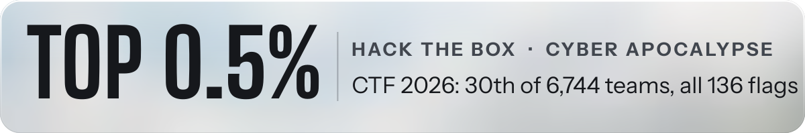

**Applied AI and agent engineering, with a security edge.** Year 2, Cybersecurity and Digital Forensics, Singapore Polytechnic. Seeking a 44-week internship in applied AI and AI security from April 2027.

<picture><source media="(prefers-color-scheme: dark)" srcset="assets/widget-tokens-dark.svg"></picture>
<picture><source media="(prefers-color-scheme: dark)" srcset="assets/widget-github-dark.svg"></picture>
<picture><source media="(prefers-color-scheme: dark)" srcset="assets/widget-htb-dark.svg"></picture>

**Agentroid** · an Android bridge for MCP agents. Any MCP client drives Android emulators, with no model API key of its own. 
Rust core, TypeScript MCP server, deny-by-default adb, a device allowlist and risk labels on every action. *Open-source release planned.*

**Unburden Root** · the multi-agent harness I build in. Claude Code sessions work as named roles with shared memory and written rules. 
Work is routed to model pools by cost and urgency, and a PII guard fails closed. *Private for now; a write-up will follow.*

[LinkedIn](https://www.linkedin.com/in/ethan-soh2008) · [Claude Certified Architect – Foundations](https://www.credly.com/badges/7f7c09e9-4bbb-4cff-a49d-ee5d9e4dae23) · [ISC2 Certified in Cybersecurity](https://www.credly.com/badges/668ff067-c2b0-43aa-ab9d-a386ec7f1476)

The banner is my TV's wallpaper, rebuilt as one SVG by <code>tools/build.py</code>: painting, then name, then the painting's depth cut-out. Tokens are Claude Code's own count from my laptop; the GitHub tile is redrawn daily by an Action.
