

**I build harnesses and tools for AI agents**: MCP servers, Claude Code hooks, model routing, and the guards around them. I'm in Year 2 of Cybersecurity and Digital Forensics at Singapore Polytechnic, seeking a 44-week internship in applied AI and AI security from 12 April 2027.

<a href="https://github.com/Sohwhat6420/Sohwhat6420/raw/main/Ethan-Soh-CV.pdf"><picture><source media="(prefers-color-scheme: dark)" srcset="assets/cv-download-dark.svg"></picture></a>

Short on time? <a href="https://github.com/Sohwhat6420/Sohwhat6420/raw/main/Ethan-Soh-CV-1-page.pdf">The one-page version</a>. Or find me on <a href="https://www.linkedin.com/in/ethan-soh2008">LinkedIn</a>.

<picture>
  <source media="(prefers-color-scheme: dark)" srcset="assets/typing-dark.svg">
  
</picture>

<picture><source media="(prefers-color-scheme: dark)" srcset="assets/about-contrib-dark.svg"></picture>
<picture><source media="(prefers-color-scheme: dark)" srcset="assets/about-tokens-dark.svg"></picture>
<picture><source media="(prefers-color-scheme: dark)" srcset="assets/about-projects-dark.svg"></picture>

Token tile: /stats counts each part of a reply separately; counted once per reply across Claude, Gemini and Codex it is 67.5 B.

<picture>
  <source media="(prefers-color-scheme: dark)" srcset="assets/s01-featured-dark.svg">
  
</picture>

<a href="https://github.com/Sohwhat6420/agentroid-mcp"><picture>
  <source media="(prefers-color-scheme: dark)" srcset="assets/feature-agentroid-dark.svg">
  
</picture></a>

<a href="https://github.com/Sohwhat6420/human-llm-council"><picture><source media="(prefers-color-scheme: dark)" srcset="assets/feature-human-llm-council-dark.svg"></picture></a>
<a href="https://github.com/Sohwhat6420/headless-kit"><picture><source media="(prefers-color-scheme: dark)" srcset="assets/feature-headless-kit-dark.svg"></picture></a>
<a href="https://github.com/Sohwhat6420/designyourtv"><picture><source media="(prefers-color-scheme: dark)" srcset="assets/feature-designyourtv-dark.svg"></picture></a>
<picture><source media="(prefers-color-scheme: dark)" srcset="assets/feature-show-me-your-agents-dark.svg"></picture>

<picture>
  <source media="(prefers-color-scheme: dark)" srcset="assets/s02-security-dark.svg">
  
</picture>

**Security is the other half of the work.** ISC2 Certified in Cybersecurity, a Distinction in Digital Forensics and Investigation, and the CTF results below. It carries into the agent work: my tools treat what they fetch as data, never as instructions, and Agentroid's screen guard refused or held all 44 hostile test cases in its public red-team.

<picture>
  <source media="(prefers-color-scheme: dark)" srcset="assets/track-record-dark.svg">
  
</picture>

<picture>
  <source media="(prefers-color-scheme: dark)" srcset="assets/s03-also-built-dark.svg">
  
</picture>

<picture><source media="(prefers-color-scheme: dark)" srcset="assets/mini-unburden-root-dark.svg"></picture>
<picture><source media="(prefers-color-scheme: dark)" srcset="assets/mini-bb-5th-coy-admin-portal-dark.svg"></picture>
<a href="https://github.com/Sohwhat6420/designyourwindows"><picture><source media="(prefers-color-scheme: dark)" srcset="assets/mini-designyourwindows-dark.svg"></picture></a>
<a href="https://github.com/Sohwhat6420/sidemic"><picture><source media="(prefers-color-scheme: dark)" srcset="assets/mini-sidemic-dark.svg"></picture></a>
<a href="https://github.com/Sohwhat6420/android-film-simulations"><picture><source media="(prefers-color-scheme: dark)" srcset="assets/mini-film-simulations-dark.svg"></picture></a>
<picture><source media="(prefers-color-scheme: dark)" srcset="assets/mini-building-now-dark.svg"></picture>

Earlier work: I wrote and checked the 6093 Biology papers a tuition centre now uses (Alchemy Education Studio, Feb 2025 to Oct 2026), and built a harness that drafts them from a reference library and checks the format.

<picture>
  <source media="(prefers-color-scheme: dark)" srcset="assets/divider-weather-dark.svg">
  
</picture>

The banner is my TV's home screen itself: <code>tools/capture_tv.mjs</code> opens the TV's page in a hidden headless browser with its current settings (the paintings I approved, each with its own clock face, size and depth cut-out) and films the whole rotation with the TV's own transitions. Only two things change: the clock reads ETHAN, and the widget cards carry my numbers. The extra weather (sun rays, moonlight, cloud, lightning) is <code>tools/wx-extra.js</code>, sitting where the TV's rain does, behind the cut-out. Claude usage and Claude Code tokens are read on my laptop and published to the <code>live</code> branch by <code>tools/refresh.py</code>. The paintings are oil-paint renderings made from reference images I collected; the skiing and snowboarding scenes are inspired by Werner Bronkhorst. Type: Antonio, Big Shoulders Display, Instrument Serif, Abril Fatface and Hanken Grotesk (SIL OFL 1.1). Click the banner to open it full size.

<picture>
  <source media="(prefers-color-scheme: dark)" srcset="assets/footer-concorde-dark.svg">
  
</picture>
