

<picture>
  <source media="(prefers-color-scheme: dark)" srcset="assets/typing-dark.svg">
  
</picture>

<picture><source media="(prefers-color-scheme: dark)" srcset="assets/about-helmet-dark.svg"></picture>
<picture><source media="(prefers-color-scheme: dark)" srcset="assets/about-tokens-dark.svg"></picture>
<picture><source media="(prefers-color-scheme: dark)" srcset="assets/about-bb-tkd-dark.svg"></picture>

**Applied AI and agent engineering, with a security edge.** Year 2, Cybersecurity and Digital Forensics, Singapore Polytechnic.
Seeking a 44-week internship in applied AI and AI security, from 12 April 2027.

<picture>
  <source media="(prefers-color-scheme: dark)" srcset="assets/h01-now-building-dark.svg">
  
</picture>

<picture>
  <source media="(prefers-color-scheme: dark)" srcset="assets/card-agentroid-dark.svg">
  
</picture>

<picture>
  <source media="(prefers-color-scheme: dark)" srcset="assets/card-unburden-root-dark.svg">
  
</picture>

<picture>
  <source media="(prefers-color-scheme: dark)" srcset="assets/h02-projects-dark.svg">
  
</picture>

<picture><source media="(prefers-color-scheme: dark)" srcset="assets/project-agentroid-dark.svg"></picture>
<picture><source media="(prefers-color-scheme: dark)" srcset="assets/project-unburden-root-dark.svg"></picture>
<picture><source media="(prefers-color-scheme: dark)" srcset="assets/project-bb-portal-dark.svg"></picture>
<picture><source media="(prefers-color-scheme: dark)" srcset="assets/project-show-me-your-agents-dark.svg"></picture>
<a href="https://github.com/Sohwhat6420/Sohwhat6420"><picture><source media="(prefers-color-scheme: dark)" srcset="assets/project-tv-home-screen-dark.svg"></picture></a>
<a href="https://github.com/Sohwhat6420/ST2612-EST-System"><picture><source media="(prefers-color-scheme: dark)" srcset="assets/project-st2612-est-dark.svg"></picture></a>

<picture>
  <source media="(prefers-color-scheme: dark)" srcset="assets/h03-track-record-dark.svg">
  
</picture>

<picture>
  <source media="(prefers-color-scheme: dark)" srcset="assets/track-record-dark.svg">
  
</picture>

<picture>
  <source media="(prefers-color-scheme: dark)" srcset="assets/divider-weather-dark.svg">
  
</picture>

The banner is my TV's home screen, rebuilt as one SVG by <code>tools/hero.py</code> from the page itself: the paintings I approved for it, each with its own clock face, size and depth cut-out, the TV's crossfade and letter morph, and its widget cards carrying my numbers. Claude usage and Claude Code tokens are read on my laptop and published to the <code>live</code> branch by <code>tools/refresh.py</code>; GitHub numbers are redrawn daily by an Action. The paintings are oil-paint renderings made from reference images I collected; the three skiing, snowboarding and street scenes are inspired by Werner Bronkhorst. Type: Antonio, Big Shoulders Display, Instrument Serif, Abril Fatface and Hanken Grotesk (SIL OFL 1.1), outlined into paths. Click the banner to open it full size.

<picture>
  <source media="(prefers-color-scheme: dark)" srcset="assets/footer-concorde-dark.svg">
  
</picture>
