<picture>
  <source media="(prefers-color-scheme: dark)" srcset="assets/hero-dark.svg">
  
</picture>

<picture>
  <source media="(prefers-color-scheme: dark)" srcset="assets/typing-dark.svg">
  
</picture>

**Applied AI and agent engineering, with a security edge.** Year 2, Cybersecurity and Digital Forensics, Singapore Polytechnic.
Seeking a 44-week internship in applied AI and AI security, from 12 April 2027.

 

<picture>
  <source media="(prefers-color-scheme: dark)" srcset="assets/h01-now-building-dark.svg">
  
</picture>

<picture>
  <source media="(prefers-color-scheme: dark)" srcset="assets/card-agentroid-dark.svg">
  
</picture>

**Agentroid** is an Android agent bridge for MCP clients. Any MCP-capable agent can operate Android emulators with no model API key, because the calling agent is the brain. Rust core, TypeScript MCP server, deny-by-default adb, a device allowlist and risk labels on every action. *Open-source release planned.*

<picture>
  <source media="(prefers-color-scheme: dark)" srcset="assets/card-unburden-root-dark.svg">
  
</picture>

**Unburden Root** is the harness I work in every day. It runs Claude Code sessions as named roles with hooks, persistent memory and written rulings, routes work across model pools by cost and urgency, and has a PII guard that fails closed. *Private; a write-up will follow.*

 

<picture>
  <source media="(prefers-color-scheme: dark)" srcset="assets/h02-toolkit-dark.svg">
  
</picture>

<picture>
  <source media="(prefers-color-scheme: dark)" srcset="assets/toolkit-dark.svg">
  
</picture>

Every Singapore Polytechnic module so far

- Digital Forensics and Investigation (Distinction)
- Personal Branding and Career Agility (Distinction)
- Ethical Hacking Essentials
- Offensive Security
- Linux Administration and Security
- Securing Microsoft Windows
- Infocomm Security and Network Fundamentals
- Back-End Web Development
- Front-End Web Development
- Programming Methodology
- Computer Organisation
- AI for Impact
- Data and Digital Literacy
- Malware Reverse Engineering (in progress)
- Applied Cryptography (in progress)
- Data Protection for Cyber Security (in progress)
- Sustainable Innovation Project (in progress)

 

<picture>
  <source media="(prefers-color-scheme: dark)" srcset="assets/h03-track-record-dark.svg">
  
</picture>

<picture>
  <source media="(prefers-color-scheme: dark)" srcset="assets/track-record-dark.svg">
  
</picture>

 

<picture>
  <source media="(prefers-color-scheme: dark)" srcset="assets/h04-find-me-dark.svg">
  
</picture>

<picture>
  <source media="(prefers-color-scheme: dark)" srcset="assets/footer-dark.svg">
  
</picture>

Every image here is a hand-built SVG, generated by <code>tools/build.py</code>: the koi bend with path morphing, the pond is CSS and SMIL, and all motion stops under "reduce motion". Type: Instrument Serif, Instrument Sans and JetBrains Mono (SIL OFL 1.1), outlined into paths.
