<picture><source media="(prefers-color-scheme: dark)" srcset="assets/typing-dark.svg"></picture>

<picture><source media="(prefers-color-scheme: dark)" srcset="assets/about-contrib-dark.svg"></picture>
<picture><source media="(prefers-color-scheme: dark)" srcset="assets/about-tokens-dark.svg"></picture>
<picture><source media="(prefers-color-scheme: dark)" srcset="assets/about-projects-dark.svg"></picture>

Token tile: /stats counts each part of a reply separately; counted once per reply across Claude, Gemini and Codex it is 67.5 B.

<b>SP Cybersecurity &amp; Digital Forensics | ISC2 CC | Anthropic CCA-F | Offensive Security and AI Enthusiast</b> Year 2, Singapore Polytechnic. Seeking a 44-week internship in applied AI and AI security, from 12 April 2027.

<a href="https://github.com/Sohwhat6420/Sohwhat6420/raw/main/Ethan-Soh-CV.pdf"><picture><source media="(max-width: 600px) and (prefers-color-scheme: dark)" srcset="assets/cv-bar-m-dark.svg"><source media="(max-width: 600px)" srcset="assets/cv-bar-m-light.svg"><source media="(prefers-color-scheme: dark)" srcset="assets/cv-bar-dark.svg"></picture></a>

Short on time? <a href="https://github.com/Sohwhat6420/Sohwhat6420/raw/main/Ethan-Soh-CV-1-page.pdf">The one-page version</a>. Or find me on <a href="https://www.linkedin.com/in/ethan-soh2008">LinkedIn</a>.

## Projects

<a href="https://github.com/Sohwhat6420/agentroid-mcp"><picture><source media="(prefers-color-scheme: dark)" srcset="assets/project-agentroid-dark.svg"></picture></a>

<a href="https://github.com/Sohwhat6420/human-llm-council"><picture><source media="(prefers-color-scheme: dark)" srcset="assets/project-human-llm-council-dark.svg"></picture></a>
<a href="https://github.com/Sohwhat6420/headless-kit"><picture><source media="(prefers-color-scheme: dark)" srcset="assets/project-headless-kit-dark.svg"></picture></a>

<a href="https://github.com/Sohwhat6420/designyourtv"><picture><source media="(prefers-color-scheme: dark)" srcset="assets/project-tv-banner-dark.svg"></picture></a>
<picture><source media="(prefers-color-scheme: dark)" srcset="assets/project-bb-portal-dark.svg"></picture>

<picture><source media="(prefers-color-scheme: dark)" srcset="assets/project-st2612-est-dark.svg"></picture>

<picture><source media="(prefers-color-scheme: dark)" srcset="assets/project-alchemy-dark.svg"></picture>

<b>Alchemy Education Studio harness</b>: the write-up

<b>Before.</b> Building one workbook meant hours of copying questions, pasting images and formatting by hand. Human error came with it: one mistyped MCQ answer would throw off a whole answer table, and I would only find it later.

<b>After.</b> A harness of Python tools and Claude Code agents builds the book from a written format spec. It is gated, so a book cannot pass on an agent's say-so: a mechanical auditor cross-checks questions and answers, diagrams are lifted at print resolution with watermarks stripped, and every page is rendered and audited before the build can pass. I now only look through the final product for anything off.

<b>designyourtv</b> (DesignConfigurator), in more depth
<ul><li>A design-focused frontend project: painted home screens with a depth-cut clock, per-artwork type and weather, for Android TV, Windows and GitHub profile banners.</li><li>The banner at the top of this page is its own output, filmed from my TV.</li></ul>

<b>Agentroid</b>, in more depth
<ul><li>Lets an MCP agent such as Claude Code read and operate an Android phone or emulator over adb, through 27 MCP tools. The bridge makes no model calls, so it needs no model API key.</li><li>A screen guard in a Rust daemon refuses payments, transfers, factory resets, credential entry and security-setting changes, and logs every decision to a hash-chained audit log: 44 of 44 hostile test cases refused or held, with known misses published.</li><li>Public preview: tested with Claude Code on an Android 13 emulator and one physical phone; the benchmark run is in progress.</li></ul>

<b>BB 5th Coy Administration Portal</b>: case study
<ul><li>A private client project for the Boys' Brigade 5th Singapore Company: awards and attendance records, and training-programme imports. Next.js, React and Supabase; in development since July 2026.</li></ul>

<b>ST2612 EST System</b>: what the harness scored
<ul><li>A study harness for an open-book, AI-permitted end-of-semester test: a knowledge base, and an agent pipeline that drafts, adversarially audits and delivers short answers. 25/25 on a graded AI-permitted quiz; 60/60 on Section B of a mock paper.</li></ul>

## Now building

<picture><source media="(prefers-color-scheme: dark)" srcset="assets/project-pacerouter-dark.svg"></picture>

<b>PaceRouter</b>, in more depth
<ul><li>Routes each AI task to a tier by its type and by how fast the week's usage is being spent; the same pace signal holds back parallel work and tells the orchestrator which tier to use.</li><li>Sends bulk work to a batch API at half price. In development; private first, a public repository is planned.</li></ul>

<picture><source media="(prefers-color-scheme: dark)" srcset="assets/project-claude-for-hmos-lite-dark.svg"></picture>
<picture><source media="(prefers-color-scheme: dark)" srcset="assets/project-microkernel-harness-dark.svg"></picture>

Also building, no repository yet: <b>Prompt Rambler</b> (talk your way into a good prompt).

<picture><source media="(prefers-color-scheme: dark)" srcset="assets/flagship-unburden-root-dark.svg"></picture>

<b>Unburden Root</b>, in more depth
<ul><li>The multi-agent harness I run my own projects on, with named roles, shared memory and written rules.</li><li>A PII guard fails closed (it refuses when unsure) and has its own test cases. Private. Built since July 2026.</li></ul>

## Track record

<picture><source media="(prefers-color-scheme: dark)" srcset="assets/track-record-dark.svg"></picture>

<picture><source media="(prefers-color-scheme: dark)" srcset="assets/honours-dark.svg"></picture>

Paintings: oil-paint renderings made from reference images I collected; the skiing and snowboarding scenes are inspired by Werner Bronkhorst. Type: Antonio, Big Shoulders Display, Instrument Serif, Abril Fatface and Hanken Grotesk (SIL OFL 1.1).

