<picture>
  <source media="(prefers-color-scheme: dark)" srcset="assets/typing-dark.svg">
  
</picture>

<picture><source media="(prefers-color-scheme: dark)" srcset="assets/about-contrib-dark.svg"></picture>
<picture><source media="(prefers-color-scheme: dark)" srcset="assets/about-tokens-dark.svg"></picture>
<picture><source media="(prefers-color-scheme: dark)" srcset="assets/about-days-bb-tkd-dark.svg"></picture>

Token tile: /stats counts each part of a reply separately; counted once per reply across Claude, Gemini and Codex it is 67.5 B.

**Applied AI and agent engineering, with a security edge.** Year 2, Cybersecurity and Digital Forensics, Singapore Polytechnic.
Seeking a 44-week internship in applied AI and AI security, from 12 April 2027.

<a href="https://github.com/Sohwhat6420/Sohwhat6420/raw/main/Ethan-Soh-CV.pdf"><picture><source media="(prefers-color-scheme: dark)" srcset="assets/cv-download-dark.svg"></picture></a>

Short on time? <a href="https://github.com/Sohwhat6420/Sohwhat6420/raw/main/Ethan-Soh-CV-1-page.pdf">The one-page version</a>. Or find me on <a href="https://www.linkedin.com/in/ethan-soh2008">LinkedIn</a>.

<picture>
  <source media="(prefers-color-scheme: dark)" srcset="assets/h01-now-building-dark.svg">
  
</picture>

<picture>
  <source media="(prefers-color-scheme: dark)" srcset="assets/card-agentroid-dark.svg">
  
</picture>

<picture>
  <source media="(prefers-color-scheme: dark)" srcset="assets/card-unburden-root-dark.svg">
  
</picture>

<picture>
  <source media="(prefers-color-scheme: dark)" srcset="assets/h02-projects-dark.svg">
  
</picture>

<picture><source media="(prefers-color-scheme: dark)" srcset="assets/project-agentroid-dark.svg"></picture>
<picture><source media="(prefers-color-scheme: dark)" srcset="assets/project-unburden-root-dark.svg"></picture>
<picture><source media="(prefers-color-scheme: dark)" srcset="assets/project-bb-portal-dark.svg"></picture>
<picture><source media="(prefers-color-scheme: dark)" srcset="assets/project-show-me-your-agents-dark.svg"></picture>
<a href="https://github.com/Sohwhat6420/Sohwhat6420"><picture><source media="(prefers-color-scheme: dark)" srcset="assets/project-tv-home-screen-dark.svg"></picture></a>
<picture><source media="(prefers-color-scheme: dark)" srcset="assets/project-st2612-est-dark.svg"></picture>

<a href="https://github.com/Sohwhat6420/headless-kit"><picture>
  <source media="(max-width: 1011px) and (prefers-color-scheme:dark)" srcset="assets/project-headless-kit-dark-m.svg">
  <source media="(max-width: 1011px)" srcset="assets/project-headless-kit-light-m.svg">
  <source media="(prefers-color-scheme: dark)" srcset="assets/project-headless-kit-dark.svg">
  
</picture></a>

<b>headless-kit</b> is two small Node tools that an AI agent can run with no browser, no API key and no window: <code>reddit-pull</code> returns public Reddit posts and comments as one JSON line, and <code>detached-run</code> starts a Windows process that carries on after its launcher has gone. Tested, with CI on Windows and Ubuntu. Whatever they fetch is treated as untrusted data, never as instructions to the agent.

<!-- the kit's two tools -->

<!-- also public -->
<a href="https://github.com/Sohwhat6420/designyourtv"><picture><source media="(prefers-color-scheme: dark)" srcset="assets/repo-designyourtv-dark.svg"></picture></a>
<a href="https://github.com/Sohwhat6420/designyourwindows"><picture><source media="(prefers-color-scheme: dark)" srcset="assets/repo-designyourwindows-dark.svg"></picture></a>
<a href="https://github.com/Sohwhat6420/sidemic"><picture><source media="(prefers-color-scheme: dark)" srcset="assets/repo-sidemic-dark.svg"></picture></a>
<a href="https://github.com/Sohwhat6420/android-film-simulations"><picture><source media="(prefers-color-scheme: dark)" srcset="assets/repo-android-film-simulations-dark.svg"></picture></a>

<a href="https://github.com/Sohwhat6420/human-llm-council"><picture><source media="(prefers-color-scheme: dark)" srcset="assets/repo-human-llm-council-dark.svg"></picture></a>

<!-- building now -->
<picture><source media="(prefers-color-scheme: dark)" srcset="assets/building-hmos-lite-dark.svg"></picture>
<picture><source media="(prefers-color-scheme: dark)" srcset="assets/building-prompt-rambler-dark.svg"></picture>

Earlier work: I wrote and checked the 6093 Biology papers a tuition centre now uses (Alchemy Education Studio, Feb 2025 to Oct 2026), and built a harness that drafts them from a reference library and checks the format.

<picture>
  <source media="(prefers-color-scheme: dark)" srcset="assets/h03-track-record-dark.svg">
  
</picture>

<picture>
  <source media="(prefers-color-scheme: dark)" srcset="assets/track-record-dark.svg">
  
</picture>

<picture>
  <source media="(prefers-color-scheme: dark)" srcset="assets/divider-weather-dark.svg">
  
</picture>

The banner is my TV's home screen itself: <code>tools/capture_tv.mjs</code> opens the TV's page in a hidden headless browser with its current settings (the paintings I approved, each with its own clock face, size and depth cut-out) and films the whole rotation with the TV's own transitions. Only two things change: the clock reads ETHAN, and the widget cards carry my numbers. The extra weather (sun rays, moonlight, cloud, lightning) is <code>tools/wx-extra.js</code>, sitting where the TV's rain does, behind the cut-out. Claude usage and Claude Code tokens are read on my laptop and published to the <code>live</code> branch by <code>tools/refresh.py</code>. The paintings are oil-paint renderings made from reference images I collected; the skiing and snowboarding scenes are inspired by Werner Bronkhorst. Type: Antonio, Big Shoulders Display, Instrument Serif, Abril Fatface and Hanken Grotesk (SIL OFL 1.1). Click the banner to open it full size.

<picture>
  <source media="(prefers-color-scheme: dark)" srcset="assets/footer-concorde-dark.svg">
  
</picture>
